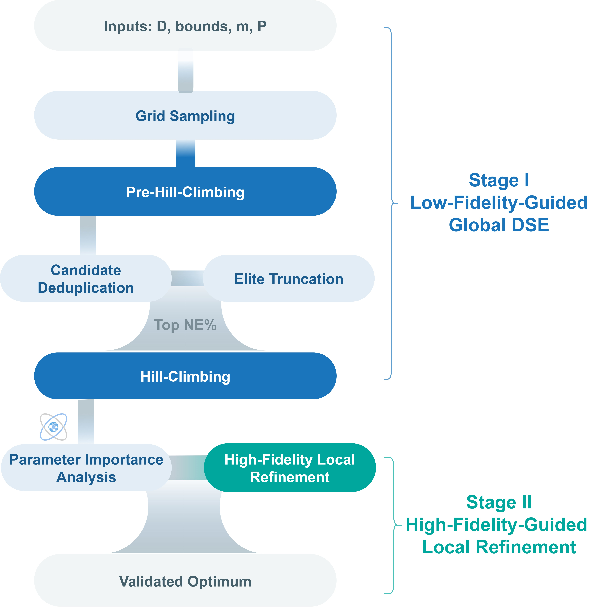

# Physics-Data Co-Driven Hybrid Algorithm (PDCHA) for Metamaterial Optimization

1. `PDCHA.py` contains the PDCHA algorithm and execution entry point. Run `python PDCHA.py`.
2. `fitness_functions.py` defines the problem. 
3. `NN.py` is the code for training the neural network using Tensorflow (v2.10.0) .
4. `petal_generator.py` calculates geometric parameters and generates the petal-shaped boundary coordinates.
5. `result_logger.py`  provide logs. Shared functions save result summaries, timing statistics, evaluation counts, and CSV files.
6. `models/NN_pc.h5` is the pretrained neural network. `data/all_parameters_valid.csv` contains the training and testing sets.
7. The reference Python environment uses ` requirements.txt`.

**Figure.** Algorithm framework of PDCHA. Stage I uses the low-fidelity model for global exploration and candidate screening. Stage II uses a limited number of high-fidelity evaluations to refine the candidate structures.

  

